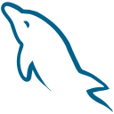

# Suleiman Abdulkadir

**DevOps & Software Engineer | AI & Cybersecurity Enthusiast**

---

## About Me

**Professional Focus:**
- Continuous learner and problem solver with a passion for innovation
- Building scalable, secure, and automated solutions by bridging development and operations
- Database design and optimization for high-performance applications
- Cloud infrastructure deployment and management with AWS expertise
<!-- - Mobile app development (Android & iOS) with modern frameworks -->

**Current Objectives:**
- Advancing cloud-native architectures and microservices
- Implementing security-first DevOps practices
- Exploring AI/ML integration in infrastructure automation
- Contributing to open-source projects and community knowledge

<!-- 

  

 -->

---

## Technical Expertise

<b style="font-size: 18px;">DevOps & Cloud Infrastructure</b>

 

  
  
  
  
  
  
  
  
  
  
  
  
  
  
  
  
  

**Specializations:** Infrastructure as Code, Container Orchestration, CI/CD Pipelines, Cloud Architecture

<b style="font-size: 18px;">Programming & Development</b>

 

  
  
  
  
  
  
  

**Focus Areas:** Backend Development, System Programming, Automation Scripts, API Development

<b style="font-size: 18px;">Web Technologies</b>

 

  
  
  
  
  
  
  
  
  
  
  
  
  
  
  
  
  

**Capabilities:** Full-Stack Development, Responsive Design, Modern Frameworks, RESTful APIs

<b style="font-size: 18px;">Mobile App Development</b>

 

  

**Platforms:** Cross-Platform Mobile Development (React Native)

<b style="font-size: 18px;">Database Technologies</b>

 

  
  
  
  
  
  
  

**Expertise:** Database Design, Query Optimization, Data Modeling, Performance Tuning

<b style="font-size: 18px;">Cybersecurity</b>

 

  
  
  
  
  
  
  
  
  

**Focus Areas:** Network Security, Penetration Testing, Vulnerability Assessment, Security Auditing

<!-- ---

## Current Focus & Learning

**Active Projects:**
- Infrastructure automation with Terraform and Ansible
- Containerized microservices architecture design
- AI-powered DevOps workflow optimization
- Real-time monitoring and alerting systems

**Learning Path:**
- Advanced Kubernetes patterns and service mesh
- Machine Learning Operations (MLOps)
- Security automation and compliance
- Serverless architecture and edge computing

--- -->

## GitHub Analytics

  

  

  

  
  

  
  

---

## Let's Connect

**Professional Networking:**
- Open to DevOps and Cloud Engineering opportunities
- Available for technical consulting and mentorship
- Interested in collaborative open-source projects
- Reach out for discussions on cloud architecture and automation

**Areas of Interest:**
- Cloud-native application development
- Infrastructure security and compliance
- DevOps culture and best practices
- Emerging technologies in AI and cybersecurity

---

  

